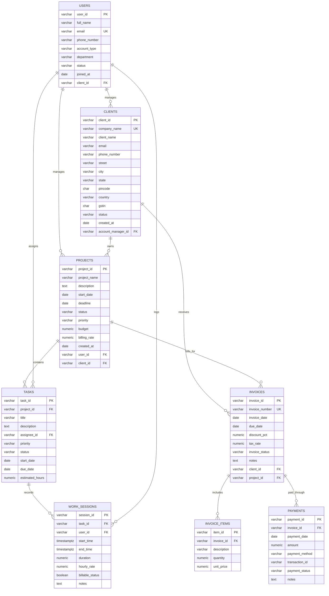

# ER Diagram

## Cardinality summary

- One client can own many projects.
- One project can have many tasks and invoices.
- One task can have many work sessions.
- One invoice can have many invoice items and many payments.
- Many-to-many project participation is represented through project_members.
